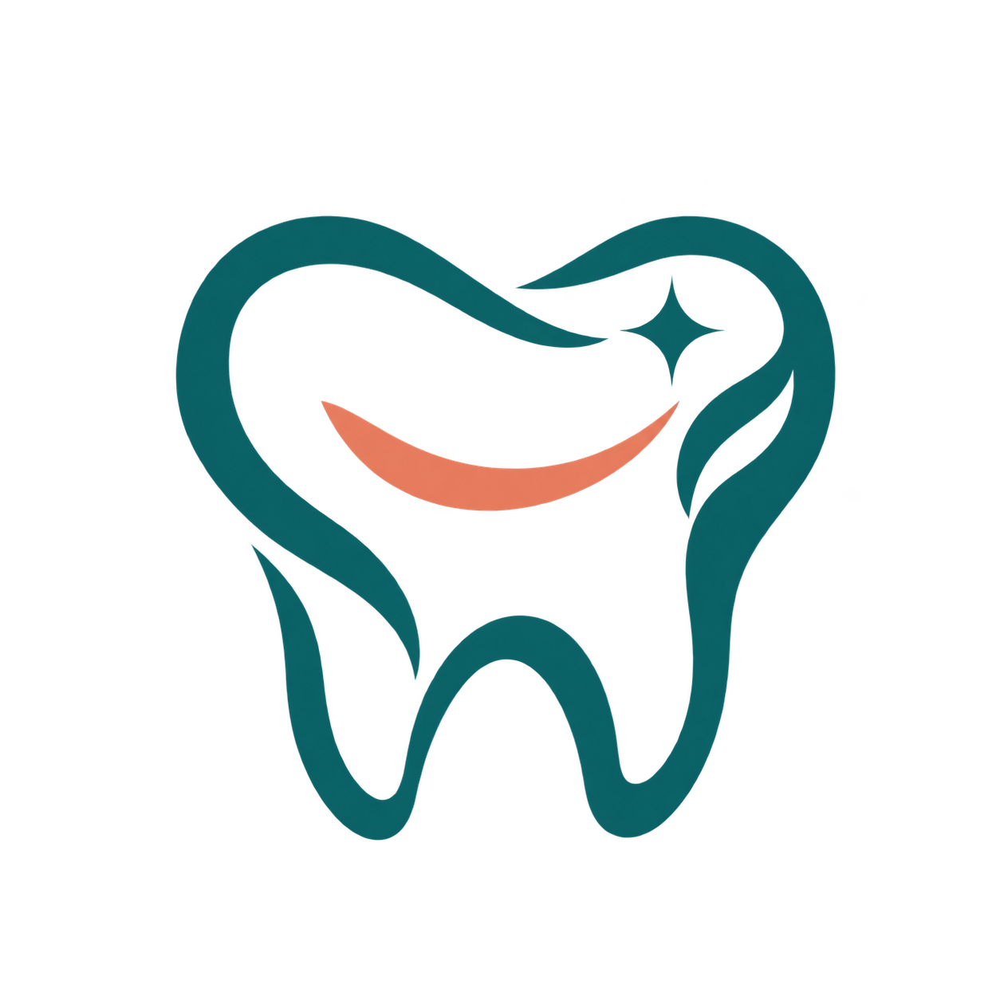

<p align="center">
  
</p>

<h1 align="center">DentalSoft</h1>

<p align="center">A Java application for managing a dental practice.</p>

DentalSoft is a student project in its early stages. The current code is the Maven starter application.

## Getting started

Install Java 25 and Maven, or enter the optional Nix development shell:

```sh
nix develop
```

Run the tests and build the project:

```sh
mvn test
mvn package
```

Java dependencies are declared in `pom.xml` and downloaded by Maven.

To run the SpotBugs scan locally after compiling:

```sh
mvn compile spotbugs:spotbugs
```

CI runs the tests and uploads SpotBugs results to GitHub code scanning.

## Database configuration

The project uses MySQL Connector/J 9.7.0, matching the driver in the pinned nixpkgs. Set these environment variables before using the database connection:

```sh
export DENTALSOFT_DB_URL="jdbc:mysql://localhost:3306/dentalsoft"
export DENTALSOFT_DB_USER="your_username"
export DENTALSOFT_DB_PASSWORD="your_password"
```

Use your own MySQL credentials. The database and its tables still need to be created; the starter application does not connect to MySQL yet.
